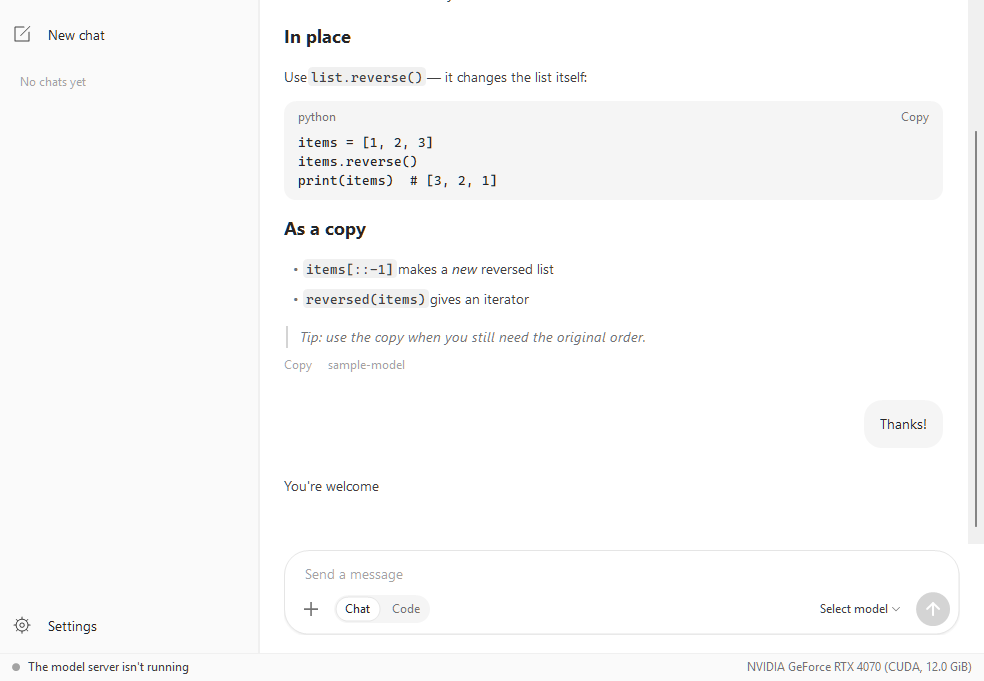

# Lplus

A small Windows desktop chat app for AI models that run on your own PC.

Lplus starts the local model server for you, keeps it running in the tray, and gives you a clean
chat window on top of it. Your chats stay on your machine.



## Download

Get `Lplus.exe` from the [latest release](https://github.com/muleskin/Lplus/releases/latest).
It is one self-contained file for 64-bit Windows, so you do not need to install .NET. Download it and run it.

The [user guide](https://github.com/muleskin/Lplus/releases/latest/download/Lplus-User-Guide.docx)
(Word) is on the same page.

## What it does

- **Chat with local models.** Replies stream in as they are written, with Markdown, code blocks
  with a Copy button, and a collapsible "thinking" section for models that reason first.
- **Model picker.** Lists the models you have installed and downloads a new one when you pick it.
- **Images.** Attach pictures for models that can see.
- **The clock.** Models that can call tools read your PC's clock, so "what time is it?" gets the
  real answer. Other models are simply told the time.
- **Chat and Code modes.** A switch in the message box. In Code mode the **+** button picks a
  project folder, and the model can list, read and search its files and, after you confirm each
  file, create or replace them, so "update my app" starts from the code you already have.
  Nothing outside that folder can be reached.
- **Copy anything.** Drag to select any text in the conversation and press Ctrl+C, or right-click
  to copy a message, the thinking, or the whole chat.
- **Prompt history.** Up and Down in an empty message box walk through your earlier prompts.
- **Chat history.** Chats are saved in a local SQLite database, grouped by Today / This week /
  Older, and can be renamed or deleted.
- **GPU status bar.** Shows your graphics card, which model is loaded, and how much of it sits in
  GPU memory.
- **Settings.** Cloud models on or off, expose the server to your network, where models are
  stored, tools and the project folder, and context length (4k to 256k).
- **Runs in the tray.** Closing the window keeps the server running; quit from the tray icon to
  stop it.

## What you need

- 64-bit Windows.
- A local model server installed. Lplus looks for it next to its own exe, in the usual install
  folder, and on your `PATH`. If a server is already answering on port 11434, Lplus uses that one.

## Building

Needs the .NET 10 SDK on Windows.

```powershell
cd app
dotnet run                                          # run from source
dotnet publish -p:PublishProfile=SingleExe          # single self-contained exe in app\publish\Lplus.exe
```

C# WinForms, drawn with its own controls. The only package is `Microsoft.Data.Sqlite`.

## Command line

| Option | What it does |
| --- | --- |
| `--selftest <report.txt> [model]` | Starts the server, lists models, asks one short question, checks the chat store, and writes a report. |
| `--toolrun <report.txt> <model> <folder> <question>` | Asks one question with the tools on and writes down every tool step and the answer. No file is ever written. |
| `--screenshot <file.png>` | Draws the window to a PNG and exits, using a throwaway copy of the database. |
| `--quit` | Asks a running copy to quit and stop the server it started. |

## Where it keeps things

`%LocalAppData%\Lplus`: `db.sqlite` (chats and settings), `app.log`, `server.log` and attached
images. Set `LPLUS_DATA_DIR` to use another folder.
